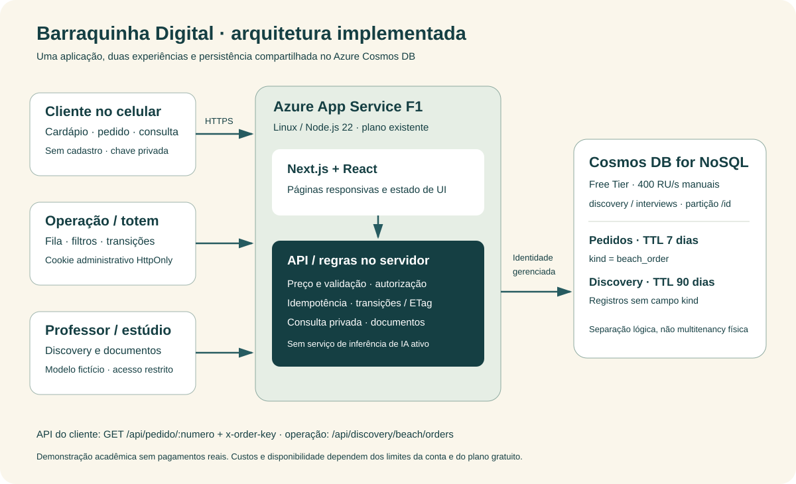

# ☀ Barraquinha Digital

Modelo acadêmico de uma aplicação de pedidos para barraca de praia: **cliente no celular + painel/totem da operação + API real + persistência no Azure Cosmos DB**. Inclui Discovery e Estúdio de Produto para documentar o caminho do problema à implementação.

**Ambiente de teste.** Dados e preços ilustrativos, sem cobrança ou entrega real. Sem modelo de ML treinado ou agente autônomo de programação integrado. Revisão do documento não equivale a validação comercial.

## Experimente

- [Cliente mobile — cardápio e pedido](https://wise-discovery-v1.azurewebsites.net/barraquinha)
- [Operação/totem — fila e estados](https://wise-discovery-v1.azurewebsites.net/barraquinha/operacao)
- [Teste da API — JSON e HTTP 200/404](https://wise-discovery-v1.azurewebsites.net/barraquinha/api)
- [Discovery Admin e Estúdio de Produto](https://wise-discovery-v1.azurewebsites.net/discovery/admin)

Cliente não exige cadastro. Operação e Admin exigem código privado: solicite ao responsável para avaliar a demonstração ou gere um código próprio ao executar localmente. **O código da demonstração não está no repositório.** Não é necessário acesso ao tenant Azure para avaliar pelo navegador.

## Comece localmente

Requisitos: Git e Node.js 22 (npm incluído). A execução local usa arquivos no diretório `data/`, sem assinatura Azure ou API de IA.

```bash
git clone https://github.com/ProfAntonioFigueiredo/barraquinha-digital.git
cd barraquinha-digital
npm ci
npm run setup:local
npm run dev -- --hostname 127.0.0.1
```

Abra http://127.0.0.1:3000/barraquinha. O código de operação é o valor `DISCOVERY_ADMIN_KEY` no arquivo local `.env.local`, criado com segredos aleatórios e ignorado pelo Git. Use exatamente127.0.0.1:3000, pois as mutações verificam a origem.

No Admin, clique **Abrir projeto Barraquinha Digital** para importar os documentos iniciais. Para preencher13 respostas/11 documentos com o exemplo fictício, use [o roteiro local](docs/EXECUCAO_LOCAL.md#preencher-o-modelo-fictício). No painel, **Carregar3 pedidos de demonstração** adiciona exemplos sem duplicar nem sobrescrever pedidos existentes.

```bash
npm run build
npm run test:discovery
npm run discovery:package
```

O teste sobe um servidor temporário e limpa seus dados. O pacote standalone é gerado em `build/discovery-azure.zip`; esse diretório não é versionado. Consulte o guia para iniciar a versão empacotada com seus assets.

## Documentação para avaliação e adaptação

| Documento | Conteúdo |
|---|---|
| [Guia do professor](docs/GUIA_PROFESSOR.md) | Acessos, demonstração e critérios verificáveis |
| [Arquitetura](docs/ARQUITETURA.md) | Desenho, componentes, segurança, persistência e sequência |
| [Telas](docs/TELAS.md) | Capturas reais do ambiente de teste e navegação |
| [Endpoints](docs/ENDPOINTS.md) | Contratos e exemplos de requisição |
| [OpenAPI3.1](docs/openapi.json) | Especificação dos endpoints |
| [Execução local](docs/EXECUCAO_LOCAL.md) | Instalação, configuração e preenchimento do caso |
| [Implantação Azure](docs/IMPLANTACAO_AZURE.md) | F1/CosmosFree, BoM, requisitos e rollback |
| [Produto e rastreabilidade](docs/PRODUTO.md) | PRD, PSS, Blueprint e ligação com testes |
| [Testes e evidências](docs/TESTES.md) | O que foi executado e o que permanece pendente |
| [Segurança e dados](docs/SEGURANCA.md) | Credenciais, retenção, limites e adaptações necessárias |
| [Prompts](prompts/README.md) | Etapas reutilizáveis e ignição do modelo |
| [Histórico disponível](docs/HISTORICO_PROMPTS.md) | Registros existentes e limites da entrega acadêmica |

## Arquitetura resumida



Um único Next.js16.2.12/React19.2.4 atende páginas e APIs. O servidor recalcula preços, autoriza a operação, valida a chave de consulta e usa identidade gerenciada para Cosmos. Pedidos e Discoveries estão no mesmo contêiner, separados logicamente pelo campo `kind`; não é isolamento físico ou solução multitenant pronta.

## Funcionalidades

- Oito produtos em duas categorias, carrinho, localização e confirmação.
- Consulta privada com número e chave do pedido; acompanhamento automático15 s.
- Fila cronológica, filtros/contadores e estados recebido→em preparo→pronto→entregue, com cancelamento permitido antes da entrega.
- Reenvio idempotente, controle de concorrência e histórico de status.
- API de teste200/404 e três pedidos demonstrativos.
- Discovery aberto e estúdio com onze artefatos; compilação de ignição e detecção de entradas desatualizadas.

## Escopo acadêmico e limitações

A versão Azure persistente foi solicitada pelo responsável. O enunciado original da disciplina pede Lovable, memória e histórico integral de prompts: **este repositório não comprova equivalência automática àquela entrega**. Confirme a aceitação com o professor.

Não há pagamento, gestão de estoque, catálogo editável, multi-barracas, login individual por funcionário, modo offline garantido ou ML treinado. F1 e ofertas gratuitas têm limites; disponibilidade e custo zero não são garantidos para qualquer carga ou conta. Não há criação automática de recursos por apenas clonar ou testar.

Autor responsável: Antonio Sergio Rodrigues Figueiredo · [ProfAntonioFigueiredo](https://github.com/ProfAntonioFigueiredo). Construção assistida por IA, com decisões e verificações documentadas. Materiais originais da disciplina e dados reais de clientes não foram incluídos. Veja [NOTICE](NOTICE).
