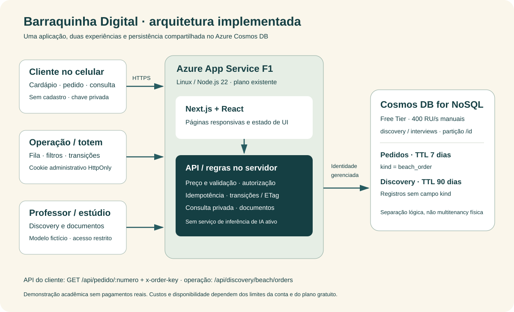
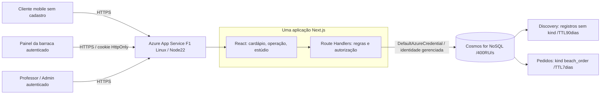

# Arquitetura implementada

## Visão de implantação





A instalação de referência usa o WebApp wise-discovery-v1 no AzureSouth Central US e Cosmos em Brazil South, conforme decisão de capacidade deF1. Mesmo banco/contêiner são reutilizados: `discovery/interviews`, partição`/id`, throughput manual400 RU/s, Free Tier habilitado. A região diferente entre aplicação e banco pode acrescentar latência. Não há garantia de quotaF1 em contas/regiões de outros alunos.

Não há VM, AKS, Redis, mensageria, serviço deIA pago ou outro contêiner Cosmos necessário para este piloto. O código tem um adaptador Blob histórico opcional no módulo Discovery; a referência publicada usa Cosmos. Os scripts deste repositório não selecionam Blob como fallback.

## Camadas e responsabilidades

| Camada | Arquivos | Responsabilidade |
|---|---|---|
| Cliente | `components/beach/Customer.tsx` | Carrinho, localização, envio, chave local e acompanhamento |
| Operação | `components/beach/Operations.tsx` | Sessão, fila, filtros, transições e polling |
| Contrato de teste | `components/beach/ApiTester.tsx` | Consulta real com número/chave e statusHTTP |
| Domínio | `lib/beach/model.ts` | Catálogo, dinheiro em centavos, enum/transições e resposta pública |
| API | `app/api/discovery/beach/orders` e `app/api/pedido/[numero]` | Validação, autorização, preço, idempotência e consulta privada |
| Persistência | `lib/beach/store.ts` | Ponto de leitura, create/replace condicional, listagem e exclusão |
| Produto | `lib/discovery/studio.ts` | Hash de entradas, estado dos documentos e compilação de ignição |
| Pesquisa | `lib/discovery/*` | Convites, respostas/consentimento e administração |

## Criação e consulta

```mermaid
sequenceDiagram
  actor C as Cliente
  participant UI as React
  participant API as API Next.js
  participant DB as Cosmos
  actor O as Operação
  C->>UI: Selecionar itens e local
  UI->>UI: Gerar requestId e chave criptográfica
  UI->>API: POST itens/local/requestId/key
  API->>API: Validar e recalcular total do catálogo
  API->>DB: Ler número derivado para idempotência
  alt Mesmo envio já existe
    DB-->>API: Pedido persistido
    API-->>UI: 200 mesmo pedido
  else Novo envio
    API->>DB: Create exclusivo; hash da chave
    DB-->>API: Confirmado
    API-->>UI: 201 pedido confirmado
  end
  O->>API: GET fila com cookie administrativo
  API->>DB: Consultar kind beach_order
  API-->>O: Fila sem chaves/hashes
  O->>API: PATCH número/status/updatedAt
  API->>DB: Replace IfMatch ETag
  C->>API: GET /api/pedido/:numero + x-order-key
  API->>DB: Point read e verificação da chave
  API-->>C: Estado persistido ou404
```

O código público do pedido não basta para consultar localização/itens: a API exige a chave privada. O segredo original não é armazenado no banco. A operação lista pedidos com sessão; o endpoint de cliente continua exigindo sua chave.

## Idempotência, concorrência e isolamento

- Número = primeiros24 caractereshex deSHA256(requestId + chave), em maiúsculas. RequestId tem16 bytes e chave32 bytes criptográficos. O mesmo envio conserva o número.
- Hash separado do corpo canônico detecta reenvio com dados diferentes e retorna409. Preço/total enviados pelo navegador não são usados.
- Alteração exige`updatedAt` atual e escrita condicional comETag. Apenas uma disputa concorrente pode substituir a versão lida; conflito retorna409.
- A máquina de estados é explícita; entregue/cancelado não voltam a recebido.
- Documentos de pedido têm`kind=beach_order` eIDprefixado; consultas de pesquisa usam`NOT IS_DEFINED(c.kind)`. Índices em`createdAt` e`kind` sustentam as consultas. Essa separação lógica não equivale a autorização multitenant.

## Execução local e nuvem

Local: arquivos atômicos em`data/discovery` e subpasta`beach`, sem Azure. Nuvem: variávelCosmos ativa adaptador obrigatório com identidade gerenciada. Se Cosmos falhar, produção não deve cair silenciosamente para arquivos locais.

Polling15 s, pausado quando a aba está oculta. Não é WebSocket e não garante atualização instantânea. O ambienteF1 pode dormir/atingir quota; o cliente deve tratar erros. Não há garantia de operação offline.
