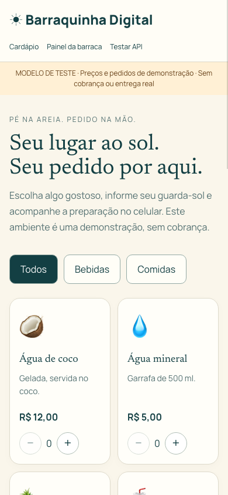
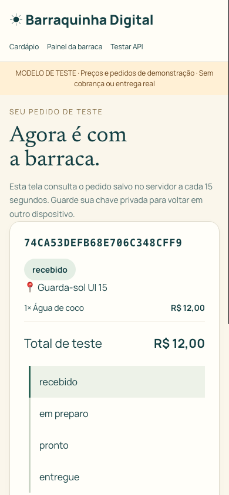
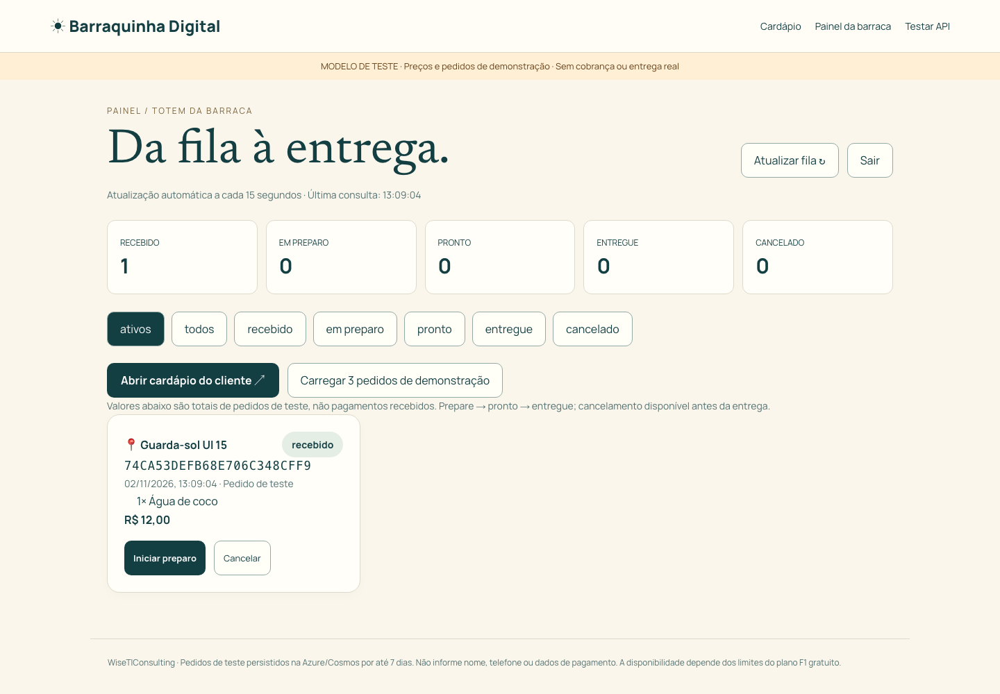
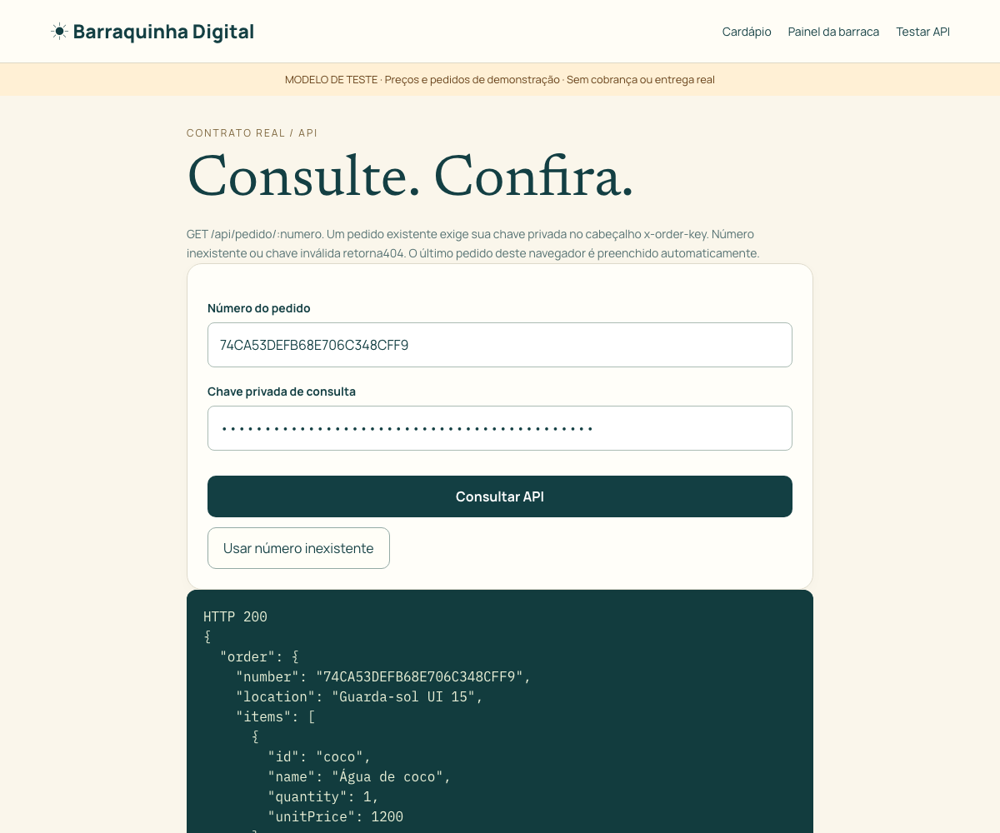
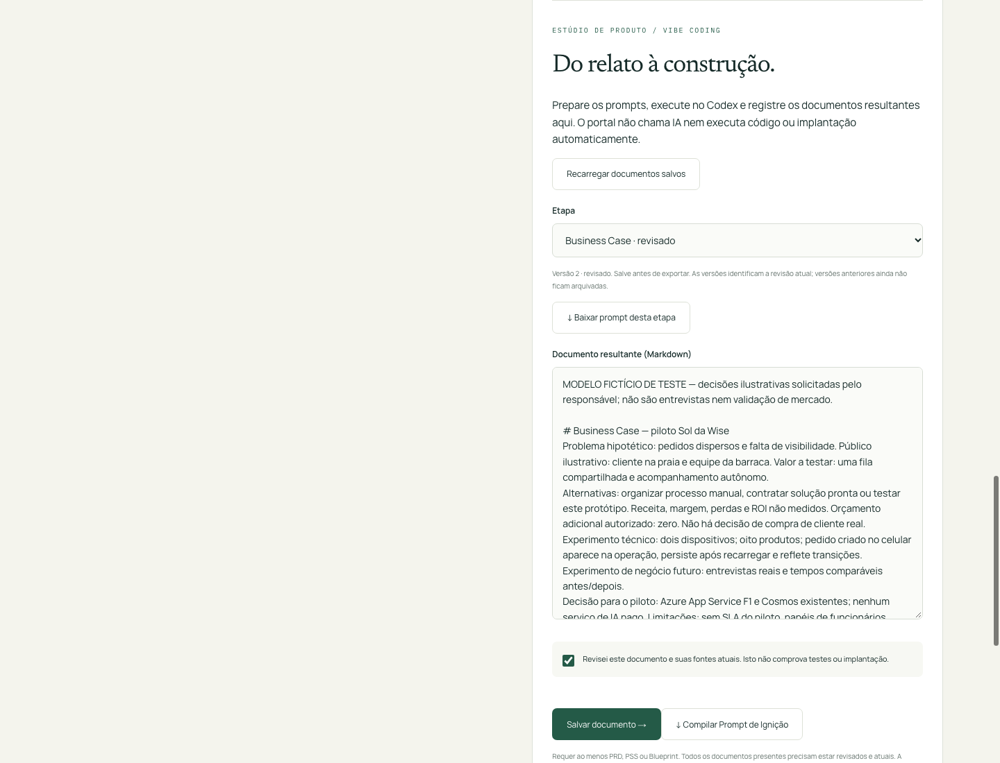

# Telas e navegação

Capturas obtidas emChrome headless com perfil temporário e dados sintéticos,02/11/2026. O teste clicou na interface mobile, criou um pedido, observou-o no painel e iniciou preparo. Não são capturas de clientes reais nem prova de teste em aparelho físico.

## Cliente — /barraquinha

Cardápio com categorias, quantidade por item, carrinho, total e guarda-sol/cadeira. Sem cadastro ou pagamento. Botões com rótulos e foco visível. A confirmação depende da resposta do backend.

## Acompanhamento — mesma rota, após confirmação

Número/local/itens/total e progresso. Consulta a cada15 s. Último pedido e chave são guardados no navegador para retomar; detalhes privados permitem copiar a referência. Quem tiver a chave pode consultar o pedido: não compartilhar.

## Operação/totem — /barraquinha/operacao

Login por código do piloto, contadores, filtros, fila cronológica e ações permitidas por estado. Em desktop, grade de cartões; em viewport estreita, uma coluna. Não existe cadastro individual de funcionários nesta versão.

## TesteAPI — /barraquinha/api

Número e chave privada; execução deGETreal; JSON e statusHTTP visíveis. A chave aparece mascarada na captura. Pode preencher último pedido do mesmo navegador ou receber dados copiados de outro aparelho. Número inexistente/chave incorreta retornam404.

## Discovery e Estúdio — /discovery/admin

Lista de conversas/projetos e botão de abertura do caso acadêmico. Estúdio contém11 documentos; o modelo tem13 respostas fictícias. Alterar entradas pode marcar documentos como desatualizados. Exportação gera prompt da etapa ou ignição dos documentos presentes revisados/atuais.

A revisão é do conteúdo do modelo, não de uma entrevista real ou validação de mercado. O contador de versão identifica a revisão atual; versões anteriores ainda não são arquivadas no estúdio.
